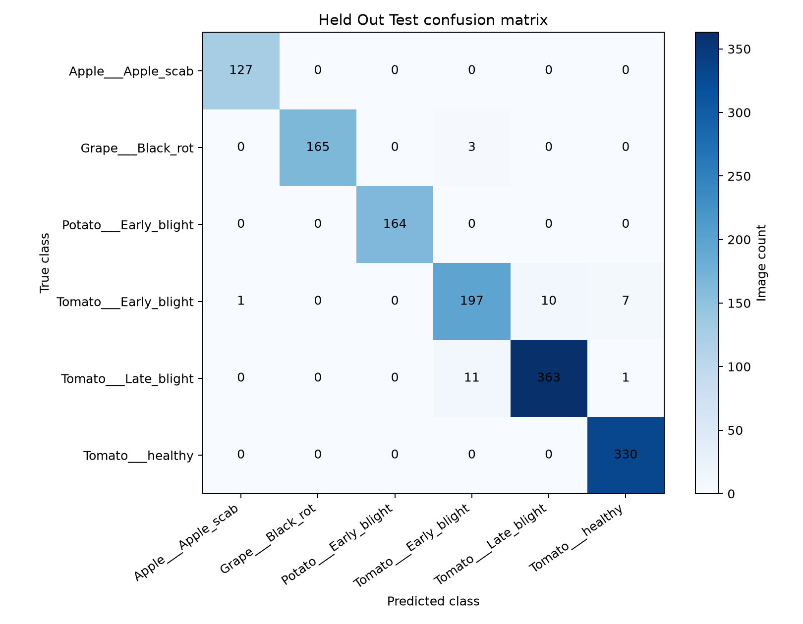

# AgriVision AI
## Crop Disease Understanding and Farmer Advisory Assistant

**Project report**

| Submission detail | Information |
|---|---|
| Submitted by | [Student name] |
| Student ID / USN | [Student ID] |
| Programme / semester | [Programme and semester] |
| Submitted to | Dr Praveen Kumar P S |
| Department | Department of Computer Science and Engineering |
| Institution | Siddaganga Institute of Technology, Tumakuru |
| Submission date | [Date] |

> Replace the bracketed student details before submission. This report
> describes the implemented prototype and its verified results as of
> 16 October 2026.

## Abstract

AgriVision AI is a prototype decision-support application for exploring
plant-leaf disease symptoms. A user uploads an image through a Streamlit
interface. A fine-tuned MobileNetV3-Small classifier predicts one of six
PlantVillage classes. A local Gemma 3 4B vision model can describe visible
features, while a retrieval-augmented generation (RAG) component searches a
small curated plant-disease knowledge base using sentence embeddings and a
FAISS index. The application combines these outputs into a farmer-oriented
advisory and states that the result is not a confirmed diagnosis.

The classifier was evaluated on 1,379 held-out PlantVillage images and
achieved 97.61% accuracy, 97.92% macro precision, 97.77% macro recall, and
97.84% macro F1. The report presents these measurements as the project's
held-out PlantVillage benchmark. Testing also covered prediction policy,
translation-output checks, knowledge retrieval, the integrated advisory
pipeline, and local application startup. The project includes an English
advisory path and optional Kannada and Hindi translation.

**Keywords:** plant disease classification, computer vision, MobileNetV3,
multimodal AI, retrieval-augmented generation, FAISS, Streamlit, uncertainty.

## 1. Introduction

Plant diseases can reduce crop health and productivity. Identifying likely
symptoms from a leaf photograph can be difficult without agricultural
knowledge. AgriVision AI explores how image classification, image-text
analysis, and retrieval of reference information can be combined in an
accessible application.

The application is a prototype decision-support tool. It is not a
plant-pathology diagnostic system, does not replace an agricultural expert,
and should not be used as the sole basis for pesticide or other treatment
decisions.

### 1.1 Problem statement

Develop a lightweight application that accepts a plant-leaf image, predicts
among a limited set of crop/disease categories, provides an explanation
informed by visible image features and curated reference material, and
communicates uncertainty and safe next steps.

### 1.2 Objectives

1. Prepare a reproducible, selected subset of the PlantVillage image data.
2. Train and evaluate a lightweight image classifier for six classes.
3. Retrieve disease reference information by semantic similarity.
4. Integrate image analysis, retrieval, and advisory text in a user interface.
5. Display confidence as an uncalibrated model score and withhold
   disease-specific advice for designated inconclusive cases.
6. Provide English output and optional Kannada and Hindi translation paths,
   while making the limits of translation checks clear.

### 1.3 Scope

The classifier recognizes only the following six labels:

| Crop | Class |
|---|---|
| Apple | Apple scab |
| Grape | Black rot |
| Potato | Early blight |
| Tomato | Early blight |
| Tomato | Late blight |
| Tomato | Healthy |

An image outside these supported classes may still receive a top-class
prediction. Therefore, classifying a supported label must not be interpreted
as proof that the crop or disease is actually present.

## 2. System overview

The application flow is:

```text
User selects crop/language and uploads a leaf image
                         |
                         v
     MobileNetV3-Small classifier (top-three class scores)
                         |
                         v
       Crop-consistency and low-score review policy
                         |
          +--------------+---------------+
          |                              |
   Inconclusive                    Advisory requested
   result; withhold                       |
   disease-specific                       v
   advice                         Gemma 3 4B visual analysis
                                         +
                             FAISS retrieval from six records
                                         |
                                         v
                         Farmer-oriented advisory in UI
                                         |
                         Optional Gemini translation
```

The Streamlit application also offers a separate text question form that
retrieves and displays relevant records from the same indexed knowledge base.
The retrieved content is reference material, not a diagnosis.

### 2.1 Main components

| Component | Implementation | Responsibility |
|---|---|---|
| User interface | Streamlit | Image upload, crop/language selection, results, knowledge questions, and session history |
| Image classifier | PyTorch and torchvision MobileNetV3-Small | Produce ranked class predictions and model scores |
| Image preprocessing | torchvision transforms and Pillow | Convert to RGB, resize to 224 × 224, normalize |
| Knowledge embedding | Sentence Transformers `all-MiniLM-L6-v2` | Encode disease descriptions and user questions |
| Similarity index | FAISS `IndexFlatIP` | Search normalized text embeddings |
| Visual analysis | Ollama with Gemma 3 4B | Describe visible leaf features from image and prompt |
| Translation | Gemini API | Optional Kannada and Hindi output from the English advisory |
| Evaluation | scikit-learn and Matplotlib | Classification metrics, score bands, and confusion-matrix visualization |

### 2.2 User workflow

1. The user opens the Streamlit application and selects the crop shown, or
   chooses the unknown/unsure option.
2. The user uploads a JPG, JPEG, PNG, or WEBP leaf image.
3. The classifier preprocesses the image and displays the top three classes
   with their scores.
4. The app checks the selected crop against the predicted crop and applies
   the score review policy.
5. When the result is eligible for further analysis, the user requests an
   advisory. The local vision model describes the image, and the retrieval
   component obtains matching reference information.
6. The app presents an English advisory with source information, safe next
   steps, and a clear AI-assessment notice. The user may choose optional
   Kannada or Hindi translation.
7. A prediction summary can be viewed in session history and cleared from
   the sidebar.

## 3. Data and preparation

### 3.1 Dataset

The project uses the PlantVillage dataset and its provided train/test split
manifests. The project brief describes the public dataset as containing
54,306 healthy and diseased leaf images across 14 crop species and 26
diseases. This implementation uses only the six classes listed above.

Selected images are extracted from the dataset archive into class-specific
folders. The predefined split manifests are used to keep the held-out test
images separate from training data. A stratified 80/20 split of the selected
training data creates the training and validation subsets.

| Subset | Images | Use |
|---|---:|---|
| Training | 4,744 | Classifier optimization |
| Validation | 1,187 | Checkpoint selection |
| Held-out test | 1,379 | Final in-distribution evaluation |
| **Total** | **7,310** | Six selected classes |

### 3.2 Image preprocessing and augmentation

Images are resized to 224 × 224 pixels, converted to tensors, and normalized
using the ImageNet channel means and standard deviations used by the
pretrained model. Training images receive random horizontal flips and random
rotations up to 10 degrees. Validation and test images use resizing and
normalization without random augmentation.

## 4. Methods and implementation

### 4.1 Image classifier

The classifier uses torchvision's pretrained MobileNetV3-Small architecture.
Its feature extractor is frozen, and the final classification layer is
replaced with a six-output linear layer. The new classification head is
trained using cross-entropy loss and the AdamW optimizer.

| Setting | Value |
|---|---|
| Input size | 224 × 224 |
| Random seed | 42 |
| Batch size | 16 |
| Maximum epochs | 8 |
| Learning rate | 0.0005 |
| Optimizer | AdamW |
| Training device | CPU |
| Checkpoint selection | Highest validation accuracy |

The final checkpoint is selected using validation accuracy. The held-out test
set is evaluated after checkpoint selection. The top softmax output is shown
as a classifier score; it is not calibrated as a probability of correctness.

### 4.2 Disease knowledge retrieval

The curated knowledge file contains six records with crop, disease/status,
symptoms, favorable conditions, and management guidance. Each record is
converted to text and embedded using
`sentence-transformers/all-MiniLM-L6-v2` (384 dimensions). Embeddings are
normalized and stored in a FAISS inner-product index, so inner product
corresponds to cosine similarity for these normalized vectors.

For a user question, the app retrieves up to three records. For an image
advisory, retrieval is based on the predicted crop and disease, and the app
keeps only a matching record. A retrieval similarity score indicates text
similarity; it is not a disease probability.

### 4.3 Visual symptom analysis and advisory

The vision component sends the uploaded image and a constrained prompt to the
locally served `gemma3:4b` model through Ollama. The prompt requests visible
features only, asks the model not to automatically agree with the classifier,
and instructs it to state uncertainty rather than assert a confirmed
diagnosis.

The advisory combines the classifier output, visual analysis, matching
retrieved reference material, cautionary wording, and practical next steps.
The user interface advises inspecting additional leaves, consulting reliable
local guidance, seeking agricultural expertise when needed, and not applying
pesticides solely on the AI assessment. The advisory is generated on demand.

### 4.4 Uncertainty policy

The app marks a prediction inconclusive if the top-class score is below 0.60
or if the user's selected crop conflicts with the predicted crop. It then
disables disease-specific advisory generation. Scores from 0.60 to below
0.85 are described as moderate; scores at or above 0.85 are described as
high. These are interface review bands. The displayed value is a classifier
score used to guide review.

The held-out test score-band results are:

| UI score band | Test images | Accuracy within band |
|---|---:|---:|
| Low: below 0.60 | 23 | 60.87% |
| Moderate: 0.60 to below 0.85 | 72 | 76.39% |
| High: 0.85 and above | 1,284 | 99.45% |

These results describe the model on the stated PlantVillage test split. They
are presented as dataset-specific measurements, while the interface
describes scores as review cues rather than calibrated probabilities.

### 4.5 User interface and translation

The Streamlit interface supports image upload, predicted crop/class and
score display, top-three predictions, crop selection, knowledge-base
questions, and session-only prediction history with a clear-history control.
Uploaded image bytes are not stored in the displayed history.

English is the default advisory language. Kannada and Hindi are optional and
use the Gemini translation API, with a project `.env` key configured outside
the report. The translation output check detects empty text, excessive
repetition, and missing Kannada or Devanagari script. The project log also
records a translation verification during development. Unit tests verify the
output checks, including Kannada and Hindi script-presence examples. The
English advisory is retained as the source text for optional translation.

### 4.6 Project technology stack

| Area | Tools and libraries |
|---|---|
| Programming language | Python |
| Deep learning | PyTorch, torchvision |
| Image handling | Pillow |
| Classifier evaluation | scikit-learn |
| Visualization | Matplotlib |
| Text embeddings | Sentence Transformers |
| Vector search | FAISS CPU |
| User interface | Streamlit |
| Local multimodal inference | Ollama, Gemma 3 4B |
| Optional translation service | Gemini API |
| Automated tests | Python `unittest` |

## 5. Evaluation and results

The evaluation uses standard multi-class classification measures. Accuracy is
the fraction of all test images classified correctly. Precision measures the
fraction of predictions for a class that are correct; recall measures the
fraction of reference images for that class that are detected. The F1 score
is the harmonic mean of precision and recall. Macro averages give each class
equal weight, while weighted averages account for class support.

### 5.1 Classifier metrics

The final test evaluation covers 1,379 held-out PlantVillage images.

| Metric | Result |
|---|---:|
| Accuracy | 97.61% |
| Macro precision | 97.92% |
| Macro recall | 97.77% |
| Macro F1 | 97.84% |
| Weighted F1 | 97.60% |

Per-class results:

| Class | Precision | Recall | F1 | Test images |
|---|---:|---:|---:|---:|
| Apple — Apple scab | 99.22% | 100.00% | 99.61% | 127 |
| Grape — Black rot | 100.00% | 98.21% | 99.10% | 168 |
| Potato — Early blight | 100.00% | 100.00% | 100.00% | 164 |
| Tomato — Early blight | 93.36% | 91.63% | 92.49% | 215 |
| Tomato — Late blight | 97.32% | 96.80% | 97.06% | 375 |
| Tomato — Healthy | 97.63% | 100.00% | 98.80% | 330 |

The most frequent confusion was between tomato early blight and late blight:
10 early-blight images were predicted as late blight, and 11 late-blight
images were predicted as early blight. The complete confusion matrix is
available below.



### 5.2 Software and integration checks

The project work log records a combination of unit, compilation, model,
retrieval, pipeline, and interface checks.

#### Automated unit tests

The focused test suite contains four prediction-policy tests and six
translation-quality tests. All 10 passed using:

```powershell
.\.venv\Scripts\python.exe -m unittest discover -s testing_files\tests -v
```

| Test area | Checks performed | Result |
|---|---|---|
| Prediction policy | Below-threshold score, score at threshold, crop mismatch, out-of-range score | 4 passed |
| Translation output | English output, empty output, repeated output, required script missing, Kannada script present, Devanagari script present | 6 passed |
| **Total** | **Focused automated unit tests** | **10 passed** |

#### Compilation and reproducibility checks

Python compilation checks completed successfully for the application,
classifier data-preparation/training code, evaluation runner, vision test,
and unit-test modules. The standalone evaluation runner was executed against
the held-out test folder and produced a JSON metrics report and labelled
confusion-matrix image. The dataset, model, class mapping, and generated
evaluation artifacts use defined project paths so the evaluation can be
re-run with the documented command.

#### Functional and integration tests

| Test | Input / procedure | Observed result |
|---|---|---|
| Single-image classifier prediction | Held-out Tomato Early blight image passed to `predict_image.py` | Tomato Early blight was the top prediction with a displayed score of 92.65% for that image. |
| Batch classifier evaluation | Run Phase 7 evaluator on the held-out PlantVillage test folder | 1,379 images evaluated; 97.61% accuracy and 97.84% macro F1. |
| FAISS retrieval | Ask a disease-related question through the retrieval script/UI | Semantic retrieval returned indexed disease information; the Streamlit result displays the record and its source. |
| Classifier + RAG pipeline | Held-out Tomato Early blight image passed through the integrated pipeline | Tomato Early blight prediction matched the corresponding Tomato/Early blight knowledge record. |
| Vision + RAG advisory smoke test | Held-out Tomato Early blight image processed by local Gemma 3 4B with RAG resources | Non-empty visual analysis, matching Tomato/Early blight record, and advisory notice were returned. |
| Streamlit application startup | Launch local app and request its local page | HTTP 200; disease-question form and prediction-history section were visible. |
| Prediction policy and history | Exercise confidence and selected-crop policy in tests; inspect the application history panel | Inconclusive policy cases pass unit tests; the application displays session-only prediction summaries and a clear-history control. |
| Translation checks | Run automated output quality tests | Empty/repetitive output and missing expected script are detected; Kannada and Hindi script examples pass. |

The single-image score is an example output for that image. The aggregate
held-out evaluation above is the model's dataset-level result; the two values
refer to different test measurements.

#### Commands for reproducing project checks

Run these commands from the project root:

```powershell
.\.venv\Scripts\python.exe -m unittest discover -s testing_files\tests -v
.\.venv\Scripts\python.exe testing_files\evaluation\run_phase7_evaluation.py
.\.venv\Scripts\python.exe -m streamlit run src\app\streamlit_app.py
```

The manual Gemma vision test is available through
`testing_files\test_vision.py`; it requires Ollama and the `gemma3:4b` model.

## 6. Project scope and responsible-use design

The prototype deliberately focuses on six classes across Apple, Grape,
Potato, and Tomato. This bounded scope makes it possible to demonstrate the
full computer-vision, retrieval, and multimodal workflow on the available
development hardware.

The interface provides clear model-score labels, crop-consistency checks,
an inconclusive state for selected cases, and advisory wording that describes
the output as AI-assisted rather than a confirmed diagnosis. It recommends
checking the whole plant and seeking local agricultural guidance when
appropriate. The user can also inspect the retrieved knowledge source and
similarity score.

The benchmark in this report is the held-out PlantVillage split. Its
measurements should be understood in that dataset context. Extending the
evaluation to separately collected field images, and having agricultural
reviewers assess visual descriptions and advisory wording, are useful next
steps for continued project development.

## 7. Conclusion

The project demonstrates an end-to-end academic prototype that brings
together lightweight image classification, local multimodal analysis,
semantic retrieval, and a farmer-oriented interface. The classifier achieved
97.61% accuracy and 97.84% macro F1 on 1,379 held-out PlantVillage images.
The documented software checks include 10 passing unit tests, a reproducible
evaluation run, a vision-and-retrieval advisory smoke test, and a successful
local Streamlit startup check. These outcomes provide a clear basis for
demonstrating the system and for future evaluation with additional image
collections and reviewer feedback.

## References

1. PlantVillage Dataset, public repository:
   <https://github.com/spMohanty/PlantVillage-Dataset>.
2. PlantVillage Dataset, Hugging Face:
   <https://huggingface.co/datasets/mohanty/PlantVillage>.
3. A. Howard et al., “Searching for MobileNetV3,” *Proceedings of the
   IEEE/CVF International Conference on Computer Vision (ICCV)*, 2019.
   <https://doi.org/10.1109/ICCV.2019.00140>.
4. Sentence Transformers, `all-MiniLM-L6-v2` model card:
   <https://huggingface.co/sentence-transformers/all-MiniLM-L6-v2>.
5. FAISS similarity-search library:
   <https://github.com/facebookresearch/faiss>.
6. Project evaluation protocol and artifacts:
   [Phase 7 evaluation report](./testing_files/evaluation/PHASE7_EVALUATION_REPORT.md),
   [classifier metrics](./testing_files/evaluation/classifier_results.json),
   and [confusion matrix](./testing_files/evaluation/held_out_test_confusion_matrix.png).
